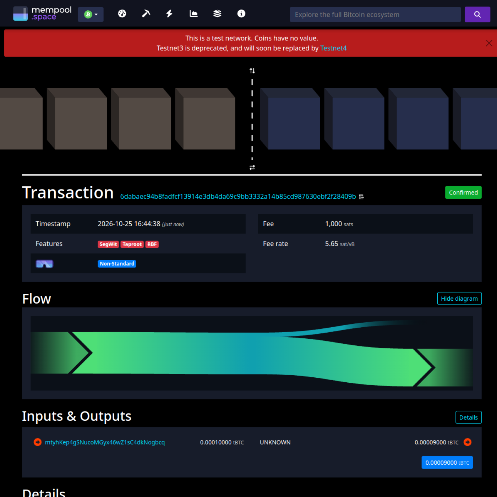
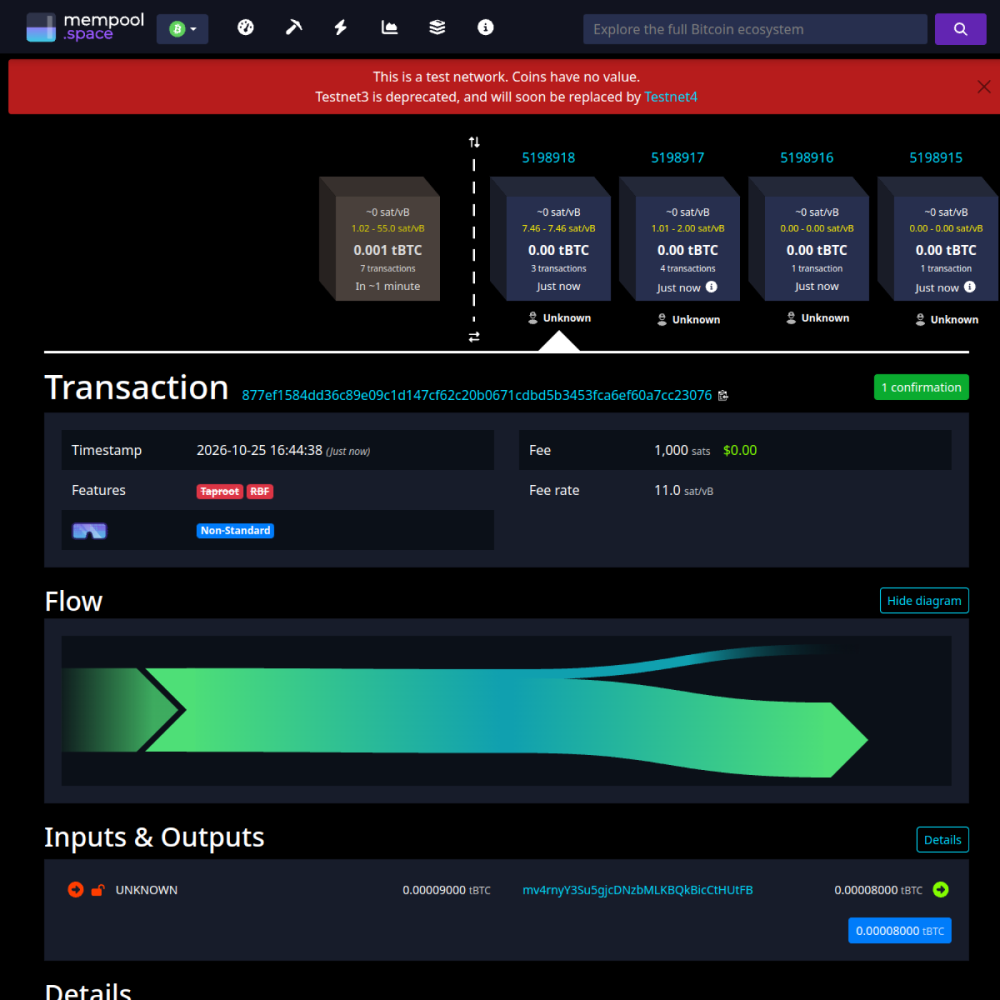

# 《区块链基础及应用》Ex3实验报告

学院：计算机及网络空间安全学院　　专业：计算机科学与技术　　姓名：李梦涛　　学号：2412483

## Ex3

### 一、项目构成

github地址：[KaGaMi9999/nku-2026-blockchains](https://github.com/KaGaMi9999/nku-2026-blockchains)

Blockchains

- Lab
    - Ex3
        - codes
            - config.py：配置我的私钥、地址与老师收币地址（沿用 Ex0/Ex1）
            - ex1.py：Ex1 的 P2PKH 实现，Ex3a 复用其中的 `send_from_P2PKH_transaction`
            - ex3a.py：完成「线性方程组」锁定脚本 `ex3a_txout_scriptPubKey`，并广播锁仓交易
            - ex3b.py：完成最小解锁脚本 `txin_scriptSig`，并广播赎回交易
            - utils.py：封装构造交易、签名、广播的工具函数（新增 ElectrumX 广播兜底）
            - requirements.txt：环境要求（python-bitcoinlib、requests）
        - documents
            - Ex3.pdf：老师下发的实验说明
        - MyReports
            - BlockChain-Ex3-2412483.md：撰写的实验报告
            - Ex3a.png：锁仓交易在 mempool.space 上的确认记录
            - Ex3b.png：赎回交易在 mempool.space 上的确认记录
            - txid.txt：两笔交易的 txid 及所在区块信息

<br>

### 二、实验内容

#### 实验目标

本实验用比特币脚本实现一个「数学谜题」：UTXO 被锁定后，只有给出某个二元一次方程组解 (x, y) 的人才能花掉它。实验分两步：

1. （a）生成一笔交易，其锁定脚本（scriptPubKey）要求满足
   x + y = 学号前 3 位，x − y = 学号后 4 位；
2. （b）赎回这笔交易，要求解锁脚本（scriptSig）**尽可能小**，即只把两个整数 x、y 压入堆栈，其余运算全部写在 scriptPubKey 里。

<br>

#### 步骤 1：求解方程组

我的学号是 **2412483**，因此

- 学号前 3 位：x + y 的右端 S = 241（奇数）
- 学号后 4 位：x − y 的右端 D = 2483（奇数）

两者奇偶性相同，不需要按题目要求「顺序加 1」调整，方程组本身就有整数解：

```
x + y = 241
x − y = 2483
```

两式相加得 2x = 2724 → **x = 1362**；两式相减得 2y = −2242 → **y = −1121**。

验证：1362 + (−1121) = 241，1362 − (−1121) = 2483。

这里 y = −1121 是负数，而比特币脚本的数值本来就支持负数（用小端序 + 最高位符号位编码），所以不需要修改学号。赎回时 `-1121` 会被编码成 `61 84` 两个字节。

<br>

#### 步骤 2：构造锁定脚本（ex3a.py）

scriptSig 只压入两个数，而脚本里要同时校验「和」与「差」，因此必须先把 x、y 复制一份，才能做两次运算。锁定脚本如下：

```python
ex3a_txout_scriptPubKey = [
    OP_2DUP,          # 复制栈顶两个数：[x, y] -> [x, y, x, y]
    OP_ADD,           # 弹出两个 y、x 相加：[x, y, x+y]
    241,              # 压入 241
    OP_EQUALVERIFY,   # 校验 x+y == 241
    OP_SUB,           # 弹出 y、x 相减：[x-y]
    2483,             # 压入 2483
    OP_EQUAL          # 校验 x-y == 2483
]
```

完整执行过程（`<1362> <{-1121}>` 由 scriptSig 压栈）：

| 步骤 | 执行操作 | 执行后堆栈 |
| --- | --- | --- |
| 0 | scriptSig 执行完 | `[1362, -1121]` |
| 1 | OP_2DUP | `[1362, -1121, 1362, -1121]` |
| 2 | OP_ADD | `[1362, -1121, 241]` |
| 3 | 压入 241 | `[1362, -1121, 241, 241]` |
| 4 | OP_EQUALVERIFY | `[1362, -1121]`（241 与 241 相等，继续执行） |
| 5 | OP_SUB | `[2483]`（计算 1362 - (-1121)） |
| 6 | 压入 2483 | `[2483, 2483]` |
| 7 | OP_EQUAL | `[TRUE]` |

脚本用 `CScript` 编码后的十六进制为：

```
6e9302f100889402b30987
```

其中 `6e`=OP_2DUP、`93`=OP_ADD、`02f100`=压入 241、`88`=OP_EQUALVERIFY、`94`=OP_SUB、`02b309`=压入 2483、`87`=OP_EQUAL。

<br>

#### 步骤 3：广播锁仓交易（ex3a.py）

`ex3a.py` 复用 Ex1 的 `send_from_P2PKH_transaction`，花费 Ex1 分币交易的第 2 号输出（0、1 号已分别在 Ex1、Ex2a 用过），把币锁进上面的谜题脚本：

```python
if __name__ == '__main__':
    amount_to_send = 0.00009          # 实发 9000 sat
    txid_to_spend = (
        'a94c1641cd0311ed2b6e33599829a128f597774e71dedb71bfe2e1699878ccb9')
    utxo_index = 2                    # 分币交易的 2 号输出，10000 sat

    response = send_from_P2PKH_transaction(
        amount_to_send, txid_to_spend, utxo_index,
        ex3a_txout_scriptPubKey)
```

运行后广播成功，返回的交易哈希为：

```
6dabaec94b8fadfcf13914e3db4da69c9bb3332a14b85cd987630ebf2f28409b
```

链上查询可知，该交易花费了 `a94c...ccb9` 的 2 号输出（10000 聪），产生一个 **9000 聪**的非标准脚本输出，差额 1000 聪作为手续费（费率 5.65 sat/vB），并在区块 **5198918** 得到确认。



<br>

#### 步骤 4：构造最小解锁脚本（ex3b.py）

方程组已解出 x = 1362、y = −1121，解锁脚本只需要把这两个整数压栈：

```python
txin_scriptSig = [1362, -1121]
```

编码后的十六进制为 `025205026184`：`02 5205` 压入 1362，`02 6184` 压入 -1121，除此之外没有任何多余操作，已经是最小形式。

<br>

#### 步骤 5：广播赎回交易（ex3b.py）

赎回交易花费锁仓交易的 0 号输出（9000 聪），把 8000 聪发回老师的 faucet 地址：

```python
amount_to_send = 0.00008              # 实发 8000 sat
txid_to_spend = '6dabaec94b8fadfcf13914e3db4da69c9bb3332a14b85cd987630ebf2f28409b'
utxo_index = 0

txin_scriptPubKey = ex3a_txout_scriptPubKey
txin_scriptSig = [1362, -1121]
txout_scriptPubKey = P2PKH_scriptPubKey(faucet_address)
```

运行 `send_from_custom_transaction` 时，`utils.py` 会先在本地用 `VerifyScript` 执行一遍 `scriptSig + scriptPubKey`，确认堆栈最终只剩一个 `TRUE` 后才广播。运行结果：

```
[broadcast] https://mempool.space/testnet/api/tx 失败: 400 sendrawtransaction RPC error: {"code":-25,"message":"bad-txns-inputs-missingorspent"}
[broadcast] https://blockstream.info/testnet/api/tx 失败: 400 sendrawtransaction RPC error -25: bad-txns-inputs-missingorspent
[broadcast] 改用 testnet.qtornado.com 的 ElectrumX 广播
200 OK (ElectrumX)
877ef1584dd36c89e09c1d147cf62c20b0671cdbd5b3453fca6ef60a7cc23076
```

赎回交易的哈希为：

```
877ef1584dd36c89e09c1d147cf62c20b0671cdbd5b3453fca6ef60a7cc23076
```

该交易与锁仓交易被打包在同一个区块 **5198918**：花费 9000 聪的谜题输出，向 `mv4rnyY3Su5gjcDNzbMLKBQkBicCtHUtFB` 发送 8000 聪，差额 1000 聪作为手续费（费率 11.0 sat/vB）。至此「用方程组的解赎回交易」的完整流程完成。



<br>

#### 关于非标准脚本的广播问题

本实验的锁定脚本包含 `OP_ADD`、`OP_SUB`、`OP_2DUP`，不属于 P2PKH/P2SH 等任何标准模板。mempool.space、blockstream.info 这类开启了标准性检查的节点会直接拒收：

```
400 sendrawtransaction RPC error: {"code":-26,"message":"scriptpubkey"}
```

而 testnet3 的节点默认策略允许中继非标准交易，因此把 `utils.py` 的广播逻辑扩展为：先尝试 mempool.space、blockstream.info，均失败后再通过运行默认策略节点的 ElectrumX（`testnet.qtornado.com:51001`）调用 `blockchain.transaction.broadcast` 广播。两笔交易最终都由矿工打包进区块 5198918（该区块只有 3 笔交易：coinbase、锁仓、赎回），交易详情页上也能看到 mempool.space 将其标记为 **Non-Standard**，但交易在共识层面完全合法。
